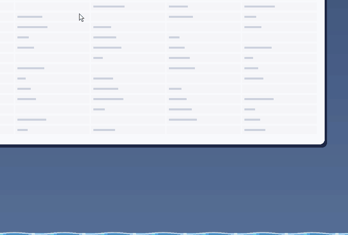
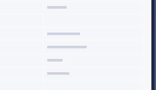
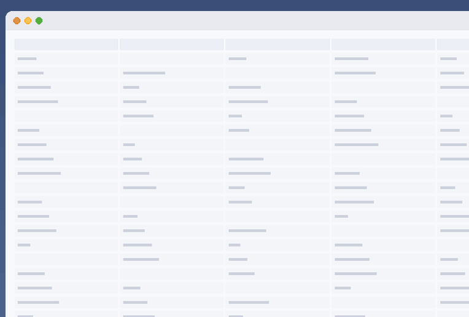
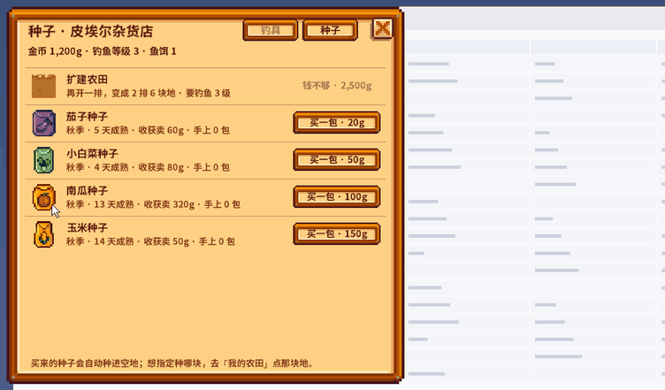
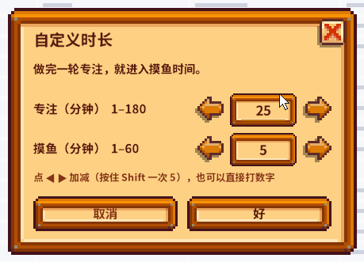

<div align="center">

# 🎣 DeskPond

**A Pomodoro timer with Stardew Valley–style fishing in your breaks.**

Focus for 25 minutes, then a pond rises at the bottom of your screen. Fish, fill your collection, go back to work.
Runs on macOS and Windows.

[](#requirements)
[](#requirements)
[](LICENSE)

[中文](README.md) · English



</div>

> Like a mod, DeskPond reads art, fonts and fish data from **your own installed copy of Stardew Valley** at runtime.
> No game assets are included in this repository — you need to own and install the game.
> The interface text is currently in Chinese (it uses the game's own Chinese font).

## Download

Make sure Stardew Valley is installed (Steam / GOG / App Store / Xbox App), then pick your system.

### Easiest: ready-to-run builds

Grab them from the **[latest release](https://github.com/SimoneScoop/DeskPond/releases/latest)** (under *Assets*) — no Python needed:

| System | Download | How to open |
| --- | --- | --- |
| **Windows** 10 / 11 | `DeskPond-Windows.zip` | Unzip → open the `DeskPond` folder → double-click `DeskPond.exe` |
| **Mac** (Apple silicon, M1 or later) | `DeskPond-macOS.zip` | Unzip → drag `DeskPond.app` into Applications → open it |

**The first launch is blocked once** because the builds aren't signed with a paid developer certificate:

- **Windows**: "Windows protected your PC" → *More info* → *Run anyway*
  - The first launch shows "reading assets from Stardew Valley" for half a minute to two minutes
  - After that it lives in the tray. **Windows often hides new tray icons behind the ^ arrow** on the taskbar — drag it onto the taskbar to keep it visible
  - If it can't start, a message box explains why; the log is at `%APPDATA%\DeskPond\deskpond.log` — please attach it to an [issue](https://github.com/SimoneScoop/DeskPond/issues)
- **Mac** (one time only):
  1. Double-click the zip to unzip it, drag `DeskPond.app` into Applications and open it
  2. macOS says *"DeskPond" cannot be opened because Apple cannot check it for malicious software* → click *OK*
  3. Open *System Settings → Privacy & Security*, scroll down to *Security*, and click *Open Anyway* next to "DeskPond was blocked"
  4. Enter your password and click *Open Anyway* again in the confirmation

  If there's no *Open Anyway* button, or macOS says the app is "damaged", run
  `xattr -cr /Applications/DeskPond.app` in Terminal and open it again

When the icon appears in the Mac menu bar or the Windows tray, it's running (the Mac app has no Dock icon).
It starts as 🎣 (the game's red-and-white bobber on Windows) and turns into fish as your collection grows — see [Menu bar / tray icon](#menu-bar--tray-icon).
For the ⌥⌘F boss key on Mac, also allow DeskPond under *System Settings → Privacy & Security → Accessibility*.

> No build for Intel Macs yet — please run from source.

### From source

[Download the source zip](https://github.com/SimoneScoop/DeskPond/archive/refs/heads/main.zip) (or `git clone`) and follow the
[macOS](#install--run-macos) or [Windows](#install--run-windows) steps below.

## Contents

- [Download](#download)
- [Demo](#demo)
- [Features](#features)
- [Requirements](#requirements)
- [Install & run: macOS](#install--run-macos)
- [Install & run: Windows](#install--run-windows)
- [How to play](#how-to-play)
- [Shortcuts](#shortcuts)
- [Menu bar / tray icon](#menu-bar--tray-icon)
- [Game mechanics](#game-mechanics)
- [FAQ](#faq)
- [Where your data lives](#where-your-data-lives)
- [Development](#development)
- [Disclaimer](#disclaimer)

## Demo

<table>
<tr>
<td align="center" width="50%"><br><sub><b>Desktop farm</b> — each finished Pomodoro is one day for your crops</sub></td>
<td align="center" width="50%"><br><sub><b>Collection</b> — styled after the in-game Collections menu</sub></td>
</tr>
<tr>
<td align="center"><br><sub><b>Shop & farm</b> — buy seeds, pick what each plot grows next</sub></td>
<td align="center"><br><sub><b>In-game style dialogs</b> — even the settings look like the game</sub></td>
</tr>
</table>

<sub>Recorded off-screen from the Windows build with `tools/make_media.py`; the macOS build looks the same. Game art shown belongs to ConcernedApe.</sub>

## Features

- **Zero distraction while you focus** — only a countdown in the menu bar / tray, plus a small farm you can hide
- **Fishing that feels like the original** — bite, reel, green bar, treasure chests, perfect catches, re-implemented from scratch; an easier "casual" mode too
- **Faithful rules** — fish appear by location, season, time of day and weather using the game's bite chances; fishing level, quality and XP follow the original
- **Discreet** — make the pond shorter, narrower or translucent; a boss key hides it instantly
- **Light progression** — collection, 39 bobbers, a tackle shop (fiberglass / iridium rods, bait, tackle), seeds and one farm expansion
- **Pomodoros grow your crops** — one finished Pomodoro = one farm day; auto-harvest, no watering, nothing ever withers
- **All original art** — UI, font and icons come from your installed game

## Requirements

| | macOS | Windows |
| --- | --- | --- |
| OS | macOS (developed on Apple Silicon) | Windows 10 / 11 |
| Python | 3.9+ | 3.9+ (tick *Add python.exe to PATH* when installing) |
| Dependencies | PyObjC (`requirements.txt`) | PySide6 (`requirements-windows.txt`) |
| Game | Stardew Valley 1.5 or 1.6 (Steam / GOG / App Store) | Stardew Valley 1.5 or 1.6 (Steam / GOG / Xbox App) |

> Both builds share all game logic; the Windows UI is a Qt port. The Windows build passes the automated
> off-screen tests but hasn't been tried on many real machines yet — [issues](../../issues) welcome.

## Install & run: macOS

> Just want to use it? Take the ready-made build from [Download](#download). These are the from-source steps.

1. Install Python 3.9+ from [python.org](https://www.python.org/downloads/macos/) if you don't have it
2. Get the code: unzip the [source zip](https://github.com/SimoneScoop/DeskPond/archive/refs/heads/main.zip) or `git clone`
3. Open Terminal in that folder (type `cd `, drag the folder into the window, press Enter) and run:

```bash
python3 -m pip install -r requirements.txt
python3 run.py
```

On first launch DeskPond finds your game and caches what it needs (about ten seconds the first time, mostly decoding the Chinese font).
If the game isn't found you'll be asked to pick it:

- Steam: `~/Library/Application Support/Steam/steamapps/common/Stardew Valley`
- App Store / other: `Stardew Valley.app`
- A `Content (unpacked)` folder from [StardewXnbHack](https://github.com/Pathoschild/StardewXnbHack) also works
- Or set it explicitly: `DESKPOND_GAME_DIR="/path/to/Stardew Valley" python3 run.py`

**The boss key needs permission**: allow the app that runs DeskPond (Terminal or your Python) under
*System Settings → Privacy & Security → Accessibility*. Until then, pressing Esc with the mouse over the pond also hides it.

## Install & run: Windows

> Just want to use it? Take `DeskPond-Windows.zip` from [Download](#download). These are the from-source steps.

1. Install Python 3.9+ from [python.org](https://www.python.org/downloads/windows/) — **tick "Add python.exe to PATH"**
2. Get the code: unzip the [source zip](https://github.com/SimoneScoop/DeskPond/archive/refs/heads/main.zip) or `git clone`
3. Open the folder, type `cmd` in the address bar, press Enter, and run:

```bat
python -m pip install -r requirements-windows.txt
python run_win.pyw
```

After that, just **double-click `run_win.pyw`** (no console window). DeskPond looks in the usual Steam (including other
Steam libraries), GOG and Xbox App locations, and asks you to pick the folder if it can't find the game.

- **Build an .exe**: double-click `tools\build_windows.bat` → `dist\DeskPond\DeskPond.exe` (still no game assets inside)
- **Start with Windows**: press Win+R, type `shell:startup`, and put a shortcut to `run_win.pyw` (or the exe) there

## How to play

1. Click the icon in the menu bar / tray → **Start focus 🍅**
2. When the focus session ends, a pond rises at the bottom of the screen
3. **Click the water** to cast — the bobber lands where you click. **Lower down means deeper water**, where bigger fish bite
4. Click again when **"!"** appears — too early scares the fish, too late lets it go
5. When the bar appears, **hold the mouse** to raise the green bar and release to drop it; keep the fish inside until the meter fills
6. When the break ends you finish your current catch, the pond sinks, and the next Pomodoro starts

Focus and fishing are independent: from idle you can also choose to just fish for a while.
Durations: 25+5, 45+10, 50+10, or custom (focus 1–180 min, break 1–60 min).

## Shortcuts

| Action | macOS | Windows |
| --- | --- | --- |
| Boss key: hide / show the pond | ⌥⌘F | Ctrl+Alt+F |
| Open the menu at the mouse (if the icon is hidden) | ⌥⌘M | Ctrl+Alt+M |
| Hide the pond while hovering it | Esc | Esc |
| Close the collection, shop and other windows | Esc / ⌘W / red ✕ | Esc / Ctrl+W / red ✕ |
| Quick menu on the pond / farm | Right-click | Right-click |
| Change pond height | Drag its top edge, double-click to reset | Same |

## Menu bar / tray icon

| When | macOS menu bar | Windows tray |
| --- | --- | --- |
| Idle | 🎣 → 🐠 after 10 species → 🐡 after 24 → 👑 when complete | Bobber → sunfish after 10 → pufferfish after 24 |
| Focusing | 🍅 24:59 | Red circle with minutes left |
| Fishing break | 🐟 04:59 | Blue circle with minutes left |
| Paused | ⏸ 12:34 | Grey circle |

## Game mechanics

<details>
<summary><b>Which fish bite</b></summary>

As in the game, it depends on **location, season, time of day and weather**:

- **Locations**: town river, mountain lake, ocean, forest river; collect 10 species to unlock the Secret Woods and 20 for the Desert
- **Season and time** follow real time: March–May is spring, June–August summer, and so on; 3 PM is 15:00 in game — night fish are for overtime
- **Weather**: one virtual weather per day (offline, stable for the day); rain fish only appear when it rains

Fish are chosen with the game's bite chances (spawn multiplier and preferred depth per fish). If nothing bites you reel in trash —
that's the original rule too; in casual mode trash gets one free re-cast. Legendary fish don't appear.
</details>

<details>
<summary><b>Progression: level, quality, treasure, bobbers</b></summary>

- **Fishing level** (0–10): XP and thresholds follow the original; higher levels give a longer green bar
- **Quality**: by size — normal / silver / gold; a perfect catch bumps it one tier, gold + perfect = iridium
- **Treasure**: about 15% of fights show a chest; keep it in the bar to collect bait, seasonal seeds or minerals
- **Bobbers**: like the 1.6 bobber machine — one new style per 2 new species, 39 in total, or random
</details>

<details>
<summary><b>Shop and gold</b></summary>

Fish and crops are sold automatically at original prices (silver ×1.25, gold ×1.5, iridium ×2). Spend the gold in the shop:

| Item | Price | Requires | Effect |
| --- | --- | --- | --- |
| Fiberglass Rod | 1,800g | Fishing 2 | Can use bait |
| Iridium Rod | 7,500g | Fishing 6 | Bait + 1 tackle slot |
| Bait | 50g / 10 | Fiberglass+ | Halves the wait for a bite |
| Spinner / Trap Bobber | 500g | Iridium Rod | Faster bites / slower progress loss |
| Cork Bobber / Treasure Hunter | 750g | Iridium Rod | Longer bar / treasure progress never drops |

The **Seeds** tab sells seasonal seeds at Pierre's prices (none in winter). Tackle never wears out and selling is automatic.
</details>

<details>
<summary><b>Farming</b></summary>

- Starting a focus session plants your seeds on empty plots (in-season first); you get a starter pack and one seed packet per day
- Each **completed** focus session is one farm day; ripe crops are harvested automatically (collection + bait + gold)
- Pick what a plot grows next in the *My Farm* window (or leave it on auto)
- **Expansion**: at fishing level 3, spend 2,500g to go from 1 row of 3 plots to 2 rows of 6 — the only size upgrade
- No punishment: stopping early just doesn't count; crops never wither, even across seasons
- **Desktop farm** (on by default): a tiny frameless farm in the game's style during Pomodoros. Soil looks watered while you focus;
  it shows only a countdown until you hover it. It floats above windows (without stealing focus) or sits on the desktop; drag to move, right-click to hide for this round
</details>

<details>
<summary><b>Game files that are read</b></summary>

| File | Used for |
| --- | --- |
| `LooseSprites/Cursors` | Fishing bar, fish, water, treasure; dialog boxes, tabs, quality stars, arrows, close button |
| `Maps/springobjects` | Icons for fish, items and seeds; the Pomodoro tomato |
| `TileSheets/emotes` | The "!" on a bite |
| `TileSheets/bobbers` | 39 bobber styles (1.6) |
| `TileSheets/crops` + `Data/Crops` | Crop sprites and growth days |
| `TerrainFeatures/hoeDirt`, `LooseSprites/Fence1` | Desktop farm soil (dry / watered) and fence |
| `TileSheets/tools` | Rod icons in the shop |
| `Data/Fish` | Difficulty, behavior, size, season, time, weather, depth and spawn rate |
| `Strings/Objects` (+ `.zh-CN`) | Names and descriptions |
| `Fonts/SmallFont.zh-CN`, `Fonts/SpriteFont1.zh-CN` | The game's own Chinese font for all UI text |

Native `.xnb` files (LZX compression, DXT textures, SpriteFonts) are decoded in pure Python — no extra tools needed.
</details>

## FAQ

**The menu bar icon disappeared.** macOS hides status icons that don't fit when the frontmost app has a long menu.
Press ⌥⌘M to open the same menu at the mouse, or ⌘-drag the icon further right.

**Why is the icon a fish now?** It's a collection reward: the idle icon changes from 🎣 to 🐠 at 10 species, 🐡 at 24 and 👑 when you've caught them all.

**Does it modify my game or saves?** No. It only reads game files; your progress is stored separately (see below).

**I used "MoyuFishing" before.** Same project, renamed. On first launch your old data folder is moved to the new name
automatically, and the old `MOYU_GAME_DIR` variable still works.

## Where your data lives

| | macOS | Windows |
| --- | --- | --- |
| Collection, gold, farm | `~/Library/Application Support/DeskPond/collection.json` | `%APPDATA%\DeskPond\collection.json` |
| Settings | `prefs.json` in the same folder | `prefs.json` in the same folder |
| Cache of what was read from the game | `game_cache/` in the same folder | `game_cache\` in the same folder |

## Development

```bash
./selfcheck.sh                                        # all tests (most run on Linux too)
python3 tests/test_qt_smoke.py --shots snapshots/win  # run the Windows build off-screen and screenshot every window
python3 tools/copy_ref.py                             # copy the game textures and fonts used into _game_ref/
python3 tools/make_media.py                           # record the README GIFs from _game_ref/
python3 tools/export_clean.py                         # export a clean copy for uploading through the GitHub website
```

**Releasing**: publish a GitHub Release (e.g. `v1.0.1`) and `.github/workflows/build.yml` builds `DeskPond-Windows.zip`
and `DeskPond-macOS.zip` on GitHub's runners and attaches them to the release. You can also run it manually from the Actions tab.

`_game_ref/`, `snapshots/` and the game cache contain game assets and are git-ignored — **never commit them**.
Game logic is platform-independent and shared; `src/ui/` is the macOS UI (PyObjC) and `src/win/` the Windows UI (Qt).
Issues and PRs are welcome — please run `./selfcheck.sh` first. See [CHANGELOG.md](CHANGELOG.md).

## Disclaimer

DeskPond is an unofficial, non-commercial fan project, not affiliated with or endorsed by ConcernedApe.
Stardew Valley and all related art, fonts and data are property of ConcernedApe LLC.
This repository contains only original code and no game asset files; the GIFs in this README are screen recordings of the program, shown for illustration.
See [NOTICE.md](NOTICE.md) for third-party code. Code is released under the [MIT License](LICENSE).
