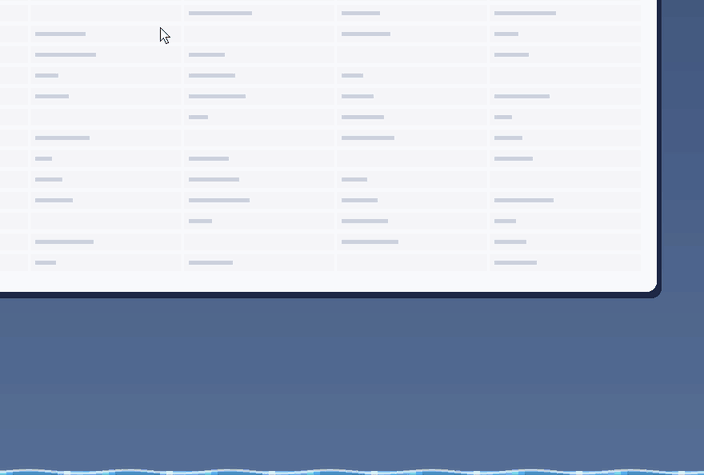
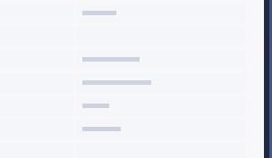
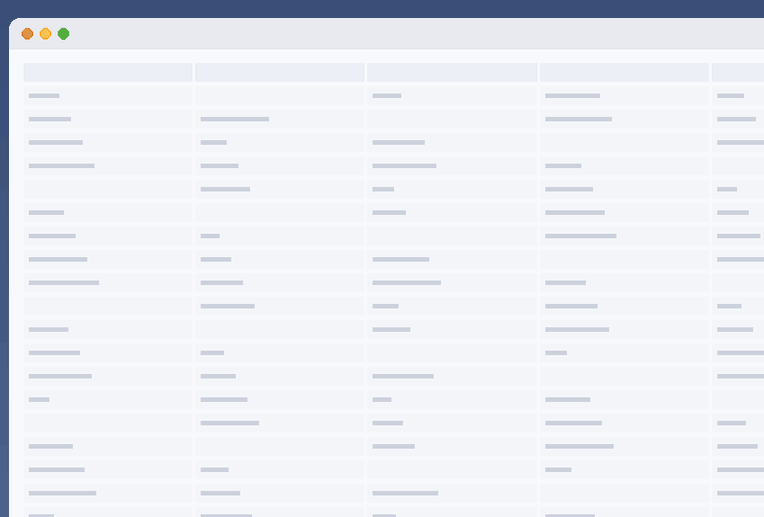
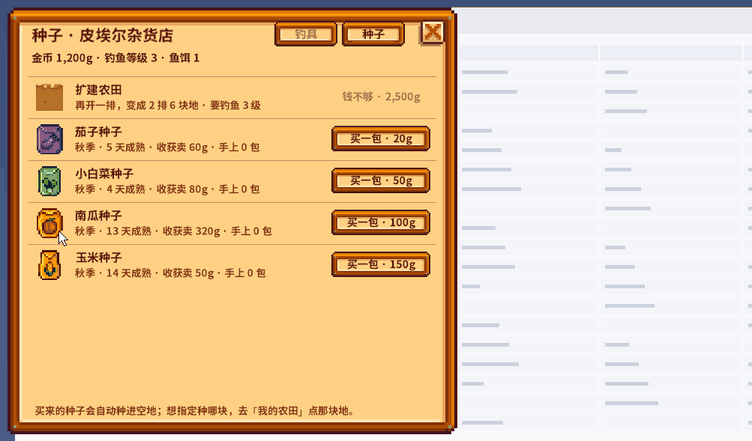
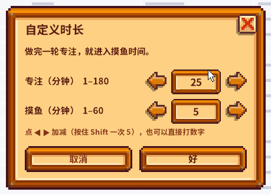

<div align="center">

# 🎣 桌面摸鱼 DeskPond

**上班摸鱼，真的在摸鱼。**

一个番茄钟 + 星露谷风格钓鱼的小工具，专注完在桌面上钓一会儿鱼。macOS / Windows 都能用。

[](#需要什么)
[](#需要什么)
[](LICENSE)

中文 · [English](README.en.md)



</div>

专注 25 分钟，屏幕底部升起一片鱼塘：抛竿、等「！」、按住鼠标溜鱼。钓到的鱼进图鉴，摸鱼时间一到，水面退下，回去干活。
每完成一个番茄，桌面上的小农田就过一天。

> 和游戏 mod 一样，美术、字体和鱼类数据都从**你电脑上安装的《星露谷物语》**里读取，仓库里不含任何游戏素材。
> 需要先拥有并安装正版《星露谷物语》。

## 下载

先确认电脑上装着正版《星露谷物语》（Steam / GOG / App Store / Xbox App 都行），然后按你的系统选。

### 普通用户：下载打包好的程序（推荐）

到 **[Releases 页面](https://github.com/SimoneScoop/DeskPond/releases/latest)** 下面的「Assets」里下载，不用装 Python：

| 系统 | 下载这个 | 怎么打开 |
| --- | --- | --- |
| **Windows** 10 / 11 | `DeskPond-Windows.zip` | 解压 → 打开 `DeskPond` 文件夹 → 双击 `DeskPond.exe` |
| **Mac**（M1 及以后的 Apple 芯片） | `DeskPond-macOS.zip` | 解压 → 把 `DeskPond.app` 拖进「应用程序」→ 双击打开 |

**第一次打开会被系统拦一下**，这是因为程序没有付费的开发者签名，属于正常情况：

- **Windows**：出现「Windows 已保护你的电脑」→ 点「更多信息」→「仍要运行」
  - 第一次打开会先弹出「正在从《星露谷物语》读取素材」，等半分钟到两分钟
  - 之后程序在右下角托盘里，**Windows 常把新图标收进任务栏右边的 ^ 小箭头**，点开就能看到；可以把它拖到任务栏上常驻
  - 打不开时会弹框说明原因，日志在 `%APPDATA%\DeskPond\deskpond.log`，发到 [Issues](https://github.com/SimoneScoop/DeskPond/issues) 里
- **Mac**（只需要做一次）：
  1. 双击 zip 解压（用系统自带的解压就行），把 `DeskPond.app` 拖进「应用程序」，双击打开
  2. 弹出「无法打开"DeskPond"，因为 Apple 无法检查其是否包含恶意软件」→ 点「好」
  3. 打开「系统设置 → 隐私与安全性」，往下拉到「安全性」，在「已阻止"DeskPond"」那一行点「仍要打开」
  4. 输入开机密码，在确认框里再点一次「仍要打开」

  如果第 3 步找不到「仍要打开」，或者提示「已损坏」：打开「终端」运行
  `xattr -cr /Applications/DeskPond.app`，再双击打开

打开后，Mac 屏幕右上角菜单栏、Windows 右下角托盘里出现图标就是开好了（Mac 版不会出现在 Dock 里）。
图标一开始是 🎣（Windows 是游戏里的红白浮漂），图鉴收集多了会变成鱼，见 [菜单栏 / 托盘图标](#菜单栏--托盘图标)。
Mac 上想用老板键 ⌥⌘F，还要在「系统设置 → 隐私与安全性 → 辅助功能」里勾上 DeskPond。

> Intel 芯片的 Mac 暂时没有打包版，请用下面的源码方式运行。

### 进阶：用源码运行

不会用 git 的话，点 **[下载源码 zip](https://github.com/SimoneScoop/DeskPond/archive/refs/heads/main.zip)**，解压后按
[macOS](#安装与运行macos) 或 [Windows](#安装与运行windows) 的步骤来；会用 git 就直接 `git clone`。

## 目录

- [下载](#下载)
- [看看效果](#看看效果)
- [特点](#特点)
- [需要什么](#需要什么)
- [安装与运行：macOS](#安装与运行macos)
- [安装与运行：Windows](#安装与运行windows)
- [怎么玩](#怎么玩)
- [快捷键](#快捷键)
- [菜单栏 / 托盘图标](#菜单栏--托盘图标)
- [菜单一览](#菜单一览)
- [玩法细节](#玩法细节)
- [常见问题](#常见问题)
- [数据放在哪](#数据放在哪)
- [开发](#开发)
- [声明](#声明)

## 看看效果

<table>
<tr>
<td align="center" width="50%"><br><sub><b>桌面农田</b>：番茄钟推动作物生长，鼠标移上去才显示详情</sub></td>
<td align="center" width="50%"><br><sub><b>图鉴</b>：原版「收藏」菜单的样子</sub></td>
</tr>
<tr>
<td align="center"><br><sub><b>钓具店和农田</b>：买种子，点一块地选下次种什么</sub></td>
<td align="center"><br><sub><b>原版风格的对话框</b>：连设置也是游戏里的样子</sub></td>
</tr>
</table>

<sub>动图用 Windows 版离屏录制（`tools/make_media.py`），Mac 版画面一样。画面中的游戏美术归 ConcernedApe 所有。</sub>

## 特点

- **专注时零打扰**：专注期间屏幕上只有菜单栏 / 托盘里的倒计时，和一小块可以收起来的农田
- **原版手感的钓鱼**：咬钩、溜鱼、绿条、宝箱、完美钓起，参照原版重新实现；也有「轻松」难度
- **规则对齐原版**：鱼按钓点、季节、时段、天气出现，用原版的上钩概率；钓鱼等级、品质、经验照原版
- **低调**：水面可以压低、缩窄、半透明；有人过来按老板键，水面立刻消失
- **轻量的成长**：图鉴、39 种浮漂、钓具店（玻璃纤维 / 铱金钓竿、鱼饵、浮漂配件）、种子和农田扩建
- **番茄钟推动种田**：完成一个番茄 = 农田过一天，自动收获，不用浇水，作物不会枯
- **全部原版素材**：界面、字体、图标都从你安装的游戏里读

## 需要什么

| | macOS | Windows |
| --- | --- | --- |
| 系统 | macOS（在 Apple Silicon 上开发测试） | Windows 10 / 11 |
| Python | 3.9 或更新 | 3.9 或更新（安装时勾上 *Add python.exe to PATH*） |
| 依赖 | PyObjC（`requirements.txt`） | PySide6（`requirements-windows.txt`） |
| 游戏 | 《星露谷物语》1.5 或 1.6（Steam / GOG / App Store） | 《星露谷物语》1.5 或 1.6（Steam / GOG / Xbox App） |

> Windows 版和 Mac 版共用全部游戏逻辑，界面用 Qt 重写。Windows 版目前在自动化测试里离屏跑过，
> 还没有在大量真机上验证，遇到问题欢迎 [提 Issue](../../issues)。

## 安装与运行：macOS

> 只想用、不想折腾的话，直接用上面 [下载](#下载) 里的打包版。下面是用源码运行的方法。

1. 没装过 Python 的话，到 [python.org](https://www.python.org/downloads/macos/) 下载安装（3.9 或更新）
2. 下载源码：[源码 zip](https://github.com/SimoneScoop/DeskPond/archive/refs/heads/main.zip) 解压，或 `git clone`
3. 打开「终端」，进入解压出来的文件夹（输入 `cd ` 加一个空格，再把文件夹拖进终端窗口，回车），然后运行：

```bash
python3 -m pip install -r requirements.txt
python3 run.py
```

第一次启动会自动找游戏目录，读取素材后缓存起来（第一次要十几秒，主要是解码中文字体，之后很快）。
找不到游戏时会弹窗让你选，常见位置：

- Steam：`~/Library/Application Support/Steam/steamapps/common/Stardew Valley`
- App Store / 其他：`Stardew Valley.app`
- 也可以选 [StardewXnbHack](https://github.com/Pathoschild/StardewXnbHack) 解包出来的 `Content (unpacked)` 文件夹
- 或者用环境变量指定：`DESKPOND_GAME_DIR="/path/to/Stardew Valley" python3 run.py`

**老板键要授权**：全局快捷键需要在「系统设置 → 隐私与安全性 → 辅助功能」里勾选运行它的程序
（从终端启动就是「终端」或你的 Python）。没授权时菜单里会有提示，鼠标在水面上按 Esc 也能藏起来。

## 安装与运行：Windows

> 只想用、不想折腾的话，直接用上面 [下载](#下载) 里的 `DeskPond-Windows.zip`。下面是用源码运行的方法。

1. 没装过 Python 的话，到 [python.org](https://www.python.org/downloads/windows/) 下载安装（3.9 或更新），**安装时勾上「Add python.exe to PATH」**
2. 下载源码：[源码 zip](https://github.com/SimoneScoop/DeskPond/archive/refs/heads/main.zip) 解压，或 `git clone`
3. 打开解压出来的文件夹，在地址栏输入 `cmd` 回车，在弹出的黑窗口里运行：

```bat
python -m pip install -r requirements-windows.txt
python run_win.pyw
```

以后直接**双击 `run_win.pyw`** 就能启动（不弹黑窗口）。程序会自动找 Steam（包括装在其他盘的 Steam 库）、GOG、
Xbox App 的常见安装位置；找不到会让你选游戏文件夹（选 `Stardew Valley` 或里面的 `Content` 都行）。

- **自己打包成 exe**：双击 `tools\build_windows.bat`，结果在 `dist\DeskPond\DeskPond.exe`。
  同样不含游戏素材，对方电脑上也要装着游戏（Releases 里的打包版是 GitHub 自动打的，见「开发」）
- **开机自启**：Win+R 输入 `shell:startup`，把 `run_win.pyw`（或 exe）的快捷方式放进去

| | macOS | Windows |
| --- | --- | --- |
| 入口 | 菜单栏图标，专注 / 摸鱼时显示倒计时 | 右下角托盘图标：红圈专注、蓝圈摸鱼，圈里是剩余分钟 |
| 鱼塘位置 | 贴着 Dock 上沿 | 贴着任务栏上沿 |
| 老板键 | ⌥⌘F（要辅助功能授权） | Ctrl+Alt+F（不用授权） |

## 怎么玩

1. 点菜单栏 / 托盘里的图标 → **开始专注 🍅**
2. 专注结束，屏幕底部升起水面
3. **点一下水面**抛竿，浮漂落在你点的位置。**点得越靠下水越深**，喜欢深水的鱼更容易上钩、也更大
4. 浮漂上冒出 **「！」** 再点：点早了鱼被吓跑，太慢鱼会溜走
5. 竖条出现后**按住鼠标**让绿条上升、松开下落，让绿条罩住游动的小鱼，右边进度条满了就钓上来
6. 摸鱼时间结束，正在溜的那条让你钓完，然后水面退下，自动开始下一个番茄

番茄钟和摸鱼是两件独立的事：空闲时选 **「摸鱼一会儿 🐟」** 可以不开番茄钟、单独摸一塘。
时长在 **设置 → 时长** 里选 25+5、45+10、50+10，或「自定义…」（专注 1–180 分钟、摸鱼 1–60 分钟）。

## 快捷键

| 操作 | macOS | Windows |
| --- | --- | --- |
| 老板键：水面立刻消失 / 回来 | ⌥⌘F | Ctrl+Alt+F |
| 在鼠标处打开菜单（图标被挤掉时） | ⌥⌘M | Ctrl+Alt+M |
| 鼠标在水面上时藏起来 | Esc | Esc |
| 关闭图鉴、钓具店等窗口 | Esc / ⌘W / 红叉 | Esc / Ctrl+W / 红叉 |
| 水面 / 农田上的快捷菜单 | 右键 | 右键 |
| 调水面高度 | 拖水面顶边，双击恢复 | 拖水面顶边，双击恢复 |
| 自定义时长对话框 | ◀ ▶ 或直接打数字，Tab 换行，回车确定 | 同左 |

## 菜单栏 / 托盘图标

| 什么时候 | macOS 菜单栏 | Windows 托盘 |
| --- | --- | --- |
| 空闲 | 🎣 → 收集 10 种鱼后 🐠 → 24 种 🐡 → 全部 👑 | 红白浮漂 → 10 种后太阳鱼 → 24 种河豚 |
| 专注中 | 🍅 24:59 | 红圈，圈里是剩余分钟 |
| 摸鱼中 | 🐟 04:59 | 蓝圈，圈里是剩余分钟 |
| 暂停 | ⏸ 12:34 | 灰圈 |

## 菜单一览

菜单按「用得上才出现」整理：第一层只放现在能做的事，细节收在「设置」里，还用不上的东西先不出现。

1. **一行状态**：专注中 18:20 / 摸鱼中 3:10 / 空闲 · 今天钓到几条
2. **现在能做的事**（只显示当前阶段的）
   - 空闲：开始专注 / 摸鱼一会儿
   - 专注中：暂停专注 / 提前结束去摸鱼 / 放弃这个番茄
   - 摸鱼中：暂停摸鱼 / 不摸了开始专注 / 结束摸鱼；水面在时可以「藏起来」
3. **窗口**：摸鱼图鉴、我的农田、钓具店（有钱了才出现）
4. **设置 ▸**
   - **钓鱼**：钓点（只露出下一个要解锁的）、浮漂（解锁第二种以后才出现）、难度（原版手感 / 轻松）
   - **时长**：三个搭配或自定义
   - **水面**：高度 / 宽度（通栏、半屏、角落）/ 不透明度
   - **农田**：种田开关；番茄钟期间显示农田；浮在窗口上面 / 压在桌面上
   - 音效、重新读取游戏素材
5. 退出

**右键菜单**：农田上右键可以「这一轮先收起来」、不再显示、换层级、打开我的农田；
水面上右键可以藏起来、结束摸鱼、换钓点、调水面。

## 玩法细节

<details>
<summary><b>会上钩的鱼</b></summary>

和原版一样看**钓点、季节、时段、天气**：

- **钓点**：镇上河流、山顶湖、海边、煤矿森林河；图鉴收集 10 种解锁秘密森林，20 种解锁沙漠
- **季节和时段**按现实时间：3–5 月春、6–8 月夏，以此类推；下午 3 点就是游戏里的 15:00，夜里的鱼只有加班才遇得到
- **天气**：每天一个虚拟天气（不联网，同一天不变），显示在「设置 → 钓鱼」的标题上；雨天鱼只在下雨天出

挑鱼用原版的上钩概率：每种鱼有自己的生成倍率和喜欢的水深。一条都没上钩就钓到杂物（海草、绿藻、破眼镜……），
这也是原版的规矩；「轻松」难度下钓到杂物会再抛一次。传说之鱼不会出现。
</details>

<details>
<summary><b>成长：等级、品质、宝箱、浮漂</b></summary>

- **钓鱼等级**（0–10）：钓到鱼和杂物都有经验，公式和升级门槛照原版；等级越高绿条越长
- **品质**：按尺寸分普通 / 银星 / 金星；完美钓起（全程没让鱼跑出绿条）再升一档，金星 + 完美 = 铱星
- **宝箱**：溜鱼时约 15% 出现，用绿条罩住一会儿就拿到（鱼也得钓上来才算）；里面是鱼饵、当季种子或矿石宝石
- **浮漂**：照 1.6 钓鱼店的浮漂机，每多钓到 2 种鱼解锁一种，共 39 种，也可以选「随机」；在图鉴「浮漂」页点一下就换上
</details>

<details>
<summary><b>钓具店和金币</b></summary>

钓到的鱼和种出的作物自动按原版售价卖掉（银星 ×1.25、金星 ×1.5、铱星 ×2），金币在钓具店里花：

| 东西 | 价格 | 条件 | 作用 |
| --- | --- | --- | --- |
| 玻璃纤维钓竿 | 1,800g | 钓鱼 2 级 | 能挂鱼饵 |
| 铱金钓竿 | 7,500g | 钓鱼 6 级 | 能挂鱼饵 + 1 个浮漂配件 |
| 鱼饵 | 50g / 10 个 | 玻璃纤维以上 | 等鱼咬钩的时间减半 |
| 旋转亮片 / 陷阱浮标 | 500g | 铱金钓竿 | 咬钩更快 / 跑出绿条时掉得慢 |
| 软木浮标 / 寻宝者 | 750g | 铱金钓竿 | 绿条变长 / 宝箱进度不往回掉 |

「种子」标签按原版皮埃尔杂货店的价格卖当季种子（冬天不卖）：

| 季节 | 种子 |
| --- | --- |
| 春 | 防风草 20g、土豆 50g、甘蓝 70g、花椰菜 80g |
| 夏 | 小麦 10g、辣椒 40g、番茄 50g、甜瓜 80g |
| 秋 | 茄子 20g、小白菜 50g、南瓜 100g、玉米 150g |

为了轻量：配件不会磨损，也不用自己去卖东西。
</details>

<details>
<summary><b>种田</b></summary>

农田跟着番茄钟走，不出现在鱼塘里：

- **开始专注**时空地马上种上手里的种子（优先当季）；第一次送一包新手种子，每天第一个番茄也送一包
- 每**完整做完一个专注**，农田过一天：作物长一天，成熟的自动收获（记进图鉴、换鱼饵、卖钱）
- **自己选种什么**：在「我的农田」里点一块地，选它下次种哪种（不选就自动）
- **扩建**：钓鱼 3 级以后在钓具店「种子」里花 2,500g，从 1 排 3 块变成 2 排 6 块。只有这一档，不开放随意改大小
- **不惩罚**：中途停下只是这一轮不算，作物不会枯，跨季节也照样长完
- **桌面农田**（默认开）：番茄钟进行时屏幕上一小块原版样子的农田——锄地、木栅栏、作物，没有底框。
  专注时地是浇过水的深色，摸鱼时是干的；平时只显示番茄图标和倒计时，鼠标移上去才显示作物进度。
  默认浮在所有窗口上面（不抢焦点），也可以压在桌面上；拖动换位置，右键「这一轮先收起来」
</details>

<details>
<summary><b>图鉴</b></summary>

照原版「收藏」菜单的样子，左边四个标签：鱼（可以筛「现在能钓」/ 全部 / 本季 / 当前钓点）、杂物与宝物、作物、浮漂。
没收集到的是深色剪影；鼠标停在图标上弹出原版样式的说明框：名字、游戏里的描述、钓到几条、最大多大、最高品质、出没条件。
收集 10 种、24 种、全部时有称号，空闲时菜单栏图标也会跟着变。
</details>

<details>
<summary><b>读取了游戏里的哪些文件</b></summary>

| 文件 | 用途 |
| --- | --- |
| `LooseSprites/Cursors` | 钓鱼竖条、绿条、小鱼、水面、宝箱；说明框、标签、品质星、箭头、关闭按钮 |
| `Maps/springobjects` | 鱼、杂物、宝物、种子的图标；番茄钟的番茄 |
| `TileSheets/emotes` | 咬钩时的「！」 |
| `TileSheets/bobbers` | 39 种浮漂（1.6；1.5 没有，会用代码画一个） |
| `TileSheets/crops` + `Data/Crops` | 作物生长图和天数（读不了时用内置天数表） |
| `TerrainFeatures/hoeDirt`、`LooseSprites/Fence1` | 桌面农田的锄地（干 / 浇过水）和木栅栏 |
| `TileSheets/tools` | 钓具店的鱼竿图标 |
| `Data/Fish` | 鱼的难度、游法、尺寸、季节、时段、天气、水深和生成倍率 |
| `Strings/Objects` + `.zh-CN` | 中文名和描述（1.5 用 `Data/ObjectInformation`） |
| `Fonts/SmallFont.zh-CN`、`Fonts/SpriteFont1.zh-CN` | 界面文字用游戏自己的中文字体（没有就退回系统字体） |

原生 `.xnb`（含 LZX 压缩、DXT 贴图、SpriteFont）用纯 Python 解码，不需要额外工具。
</details>

## 常见问题

**菜单栏图标不见了？**
前台 App 菜单很长时，macOS 会把放不下的状态栏图标藏起来。按 ⌥⌘M 在鼠标处打开同一个菜单；
或者按住 ⌘ 把图标拖到更靠右的位置，系统会记住。

**图标怎么变成鱼了？**
这是收集奖励：图鉴收集到 10 种鱼，空闲时的图标会从 🎣 变成 🐠，24 种变 🐡，全部集齐变 👑。程序是正常的。

**老板键没反应？**
macOS 要在「辅助功能」里授权运行它的程序（见上面安装部分）；Windows 上如果被别的软件占用，菜单里会提示。

**游戏更新了 / 界面素材不对？**
菜单 → 设置 → 重新读取游戏素材。游戏文件变了也会自动重新读取。

**会改动我的游戏或存档吗？**
不会。只读取游戏文件，自己的进度单独存在下面的数据目录里，和游戏存档无关。

**以前用过「摸鱼钓鱼 / MoyuFishing」？**
这是同一个项目改名而来。第一次启动新版时，旧的数据目录会自动搬到新名字下，图鉴和金币都在；
旧的环境变量 `MOYU_GAME_DIR` 也仍然有效。

**字是系统字体，不是游戏字体？**
很老的游戏版本没有中文字体文件，会退回系统字体；其他功能不受影响。

## 数据放在哪

| | macOS | Windows |
| --- | --- | --- |
| 图鉴进度、金币、农田 | `~/Library/Application Support/DeskPond/collection.json` | `%APPDATA%\DeskPond\collection.json` |
| 设置 | 同目录 `prefs.json` | 同目录 `prefs.json` |
| 从游戏里读出来的素材缓存 | 同目录 `game_cache/` | 同目录 `game_cache\` |

删掉 `game_cache` 会在下次启动时重新生成；删掉 `collection.json` 就是从头开始。老存档升级时会自动补齐新字段，不会清空。

## 开发

```bash
./selfcheck.sh                                        # 跑全部测试（Linux 上也能跑大部分）
python3 tests/test_qt_smoke.py --shots snapshots/win  # 离屏跑一遍 Windows 版并给每个窗口截图（需要 PySide6）
python3 tools/copy_ref.py                             # 把用到的原版贴图和字体复制到 _game_ref/
python3 tools/make_media.py                           # 用 _game_ref/ 录 README 的演示动图（需要 PySide6、Pillow）
python3 tools/export_clean.py                         # 导出只含代码和文档的干净副本（网页上传 GitHub 时用）
```

**发布新版本**：在 GitHub 上发布一个 Release（比如 `v1.0.1`）后，`.github/workflows/build.yml` 会自动在 GitHub 的
Windows 和 Mac 机器上打包，把 `DeskPond-Windows.zip`、`DeskPond-macOS.zip` 挂到这个 Release 下面，不用手动上传。
也可以在 Actions 页面手动运行它，先拿打好的包试一下。

> `_game_ref/`、`snapshots/` 和游戏缓存里都是游戏素材，已经在 `.gitignore` 里，**不要提交**。
> 用 git 命令行或 GitHub Desktop 提交时 `.gitignore` 会生效；如果用网页「Upload files」拖文件夹，
> 网页不看 `.gitignore`，请先用 `tools/export_clean.py` 导出一份干净副本再上传。

**代码结构**：游戏逻辑和平台无关，两个版本共用；`ui/` 是 Mac 界面（PyObjC），`win/` 是 Windows 界面（Qt）。

```
src/
  minigame.py        钓鱼小游戏的物理（绿条、鱼的运动、进度）
  session.py         一次摸鱼的流程：升起 → 抛竿 → 咬钩 → 溜鱼 → 结果 → 退下
  pomodoro.py        番茄钟
  fishdata.py        解析 Data/Fish、原版上钩概率、杂物
  world.py           钓点、每日天气、点击位置换算水深
  progression.py     钓鱼等级、品质、经验、宝箱、浮漂解锁
  farm.py            种田：完成一个番茄 = 过一天；种子商店、扩建、每块地选种
  gear.py            钓具、鱼饵、浮漂配件、售价
  collection.py      存档
  paths.py           数据目录（含从旧名字迁移）
  gamecontent/       找游戏；解 XNB / LZX / DXT / SpriteFont；切图和缓存
  ui/
    *_model.py       两个版本共用的界面数据和排版：菜单、图鉴、农田、钓具店、对话框
    bitfont.py       用游戏字体排字（两个版本共用）
    layout.py        水面和钓鱼竖条的布局计算
    *.py             Mac 版窗口
  win/               Windows 版窗口、托盘、Win32 接口
  app.py             Mac 版入口（菜单栏、主循环）
run.py / run_win.pyw 启动脚本
docs/media/          README 的演示动图
```

钓鱼手感参数在 `src/minigame.py` 顶部；`tests/test_core.py` 用一个「0.2 秒反应延迟、15% 手抖」的模拟玩家测过各难度的胜率。

欢迎 Issue 和 PR。提 PR 前请跑一遍 `./selfcheck.sh`。更新记录见 [CHANGELOG.md](CHANGELOG.md)。

## 声明

非官方粉丝作品，与 ConcernedApe 无关，也未获其认可。Stardew Valley 及其美术、字体和数据归 ConcernedApe LLC 所有。

本仓库只包含原创代码，不含任何游戏素材文件：和游戏 mod 一样，程序在你电脑上运行时读取你自己安装的游戏文件，
读出来的图片只缓存在你本机。README 里的演示动图是程序运行画面的录屏，仅用于展示。
请不要把游戏缓存或 `_game_ref/` 提交到仓库或另行分发。第三方代码的来源和许可见 [NOTICE.md](NOTICE.md)。

代码以 [MIT](LICENSE) 许可发布。
